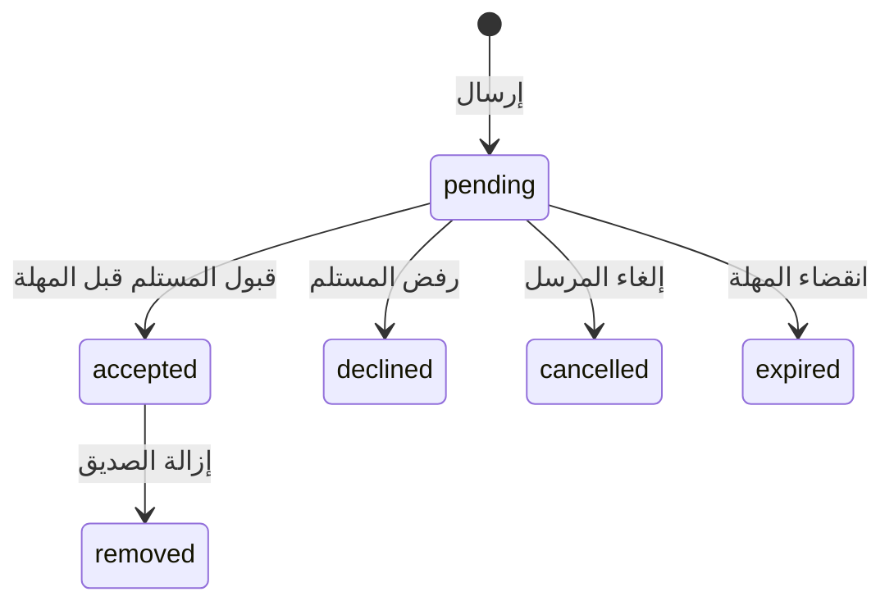

# الأصدقاء والتحديات — Social v1

النظام يضيف أصدقاء بموافقة الطرفين، واكتشاف منافسين متصلين، ودعوات لمواجهة فردية باستخدام محرك المباراة الحالي. لا توجد محادثات أو مجموعات مراسلة. البيانات مشتركة بين أجهزة الحساب، وليست محفوظة في قائمة محلية فقط.

## قواعد التصميم

| القرار | القيمة | السبب |
| --- | --- | --- |
| تحديث حالة الاتصال | كل 25 ثانية في المقدمة | توازن بين سرعة اكتشاف الانقطاع وعدد عمليات Firestore |
| صلاحية الاتصال | 75 ثانية | سقوط اللاعب من القائمة بعد فقد ثلاث تحديثات، حتى عند قتل التطبيق |
| دعوة المواجهة | 30 ثانية | دعوة قصيرة لمنافس متاح الآن |
| طلب الصداقة | 7 أيام | الموافقة لا تحتاج إلى اتصال الطرفين في اللحظة نفسها |
| مهلة بين الإرسال إلى أي لاعبين | 10 ثوانٍ لكل نوع طلب | منع تكرار الإرسال عبر تغيير المستلم |
| إعادة الطلب إلى الشخص نفسه | 30 ثانية بعد آخر تحديث | منع الإلحاح بعد الرفض أو الإلغاء |
| حجز بدء المباراة | دقيقتان | يمنع قبول دعوتين في الوقت نفسه؛ ينتهي تلقائيًا إذا تعطل البدء |
| نافذة فتح دعوة مقبولة | 30 ثانية من القبول | منع تشغيل مواجهة قديمة عند إعادة فتح التطبيق |
| قائمة المنافسين المقترحين | أحدث 60 سجل اتصال عام | إبقاء الاستعلام محدودًا؛ المتاحون أولًا ثم الأقرب في الكؤوس |

هذه قيم تشغيل أولية قابلة للضبط بعد قياس زمن قبول الدعوات، وزمن بدء المباراة، ونسبة الدعوات المنتهية، وتكلفة قراءات/كتابات الاتصال. ترتيب الكؤوس اقتراح للمنافسين؛ لا يعد نظام تقييم مهارة جديدًا أو ضمانًا لتكافؤ الخصمين.

## حالات الطلبات



`expired` حالة مشتقة من وقت الخادم، فلا تحتاج إلى مهمة تعمل على كل دعوة قديمة. إزالة الصديق تخص الصداقة فقط. الدعوة المقبولة لا تعود إلى انتظار القبول. هوية العلاقة هي معرّفا الحسابين بترتيب ثابت، فتصل العلاقة نفسها إلى الطرفين.

قبول التحدي يحدّث الدعوة ويحجز الحسابين في معاملة واحدة. قواعد Firestore ترفض الحجز الثاني حتى عند وصول قبولين بالتزامن. بعد القبول، يفتح كل جهاز محرك المواجهة الموجود مرة واحدة. سجل محلي مستقل لكل حساب يمنع إعادة تشغيل الدعوة عند إعادة تركيب الواجهة أو إعادة فتح التطبيق. العودة من المباراة تنشر حالة «متاح» وتحرر حجز الجهاز في دفعة واحدة؛ الحجز المتروك ينتهي بعد دقيقتين.

## الاتصال والتوقيت

`PlayerPresence` يتابع دورة حياة أنشطة Android، ويستمر في تحديث الحالة أثناء المباريات الأصلية، ويتوقف عن التحديث الدوري في الخلفية. حالات الاتصال: `available` و`in_match` و`away`. غرفة Flutter تُسجل انشغال اللاعب أيضًا. لا يُنشر اتصال حساب ضيف مجهول.

تُكتب نبضات الاتصال بختم وقت الخادم. وقت الواجهة والمهل يُزامن مع `.info/serverTimeOffset` عبر الجسر الأصلي، ثم يُحسب باستخدام ساعة رتيبة حتى لا يغير تعديل ساعة الهاتف المهل الجارية. تُحدّث المزامنة دوريًا. قبل وصول الوقت المزامن أو في معاينات غير Android، يُستخدم وقت الجهاز مؤقتًا؛ الخادم يبقى صاحب قرار صلاحية المهلة.

## الخصوصية والحماية

- الظهور العام اختياري؛ يستطيع الأصدقاء معرفة الاتصال عند إخفاء اللاعب، إلا عند الحظر.
- استقبال التحديات: الجميع، الأصدقاء المقبولون فقط، أو لا أحد.
- الحظر في أي اتجاه يمنع إنشاء الطلبات وقبولها. واجهة الحاظر تخفي الطرف المحظور ودعواته. الحظر لا يحذف الصداقة تلقائيًا؛ إلغاء الحظر يعيد ظهورها، ويمكن إزالة الصديق بصورة مستقلة.
- القبول والرفض للمستلم، والإلغاء للمرسل، وإزالة الصداقة المقبولة لأي طرف.
- استعلامات الصداقات والدعوات تخص المشاركين فقط؛ لا يمكن لشخص ثالث قراءة قوائمهم أو قبول دعواتهم.
- مهلات الخادم وتحديد التكرار وهويات المشاركين وحقول المستندات محفوظة بقواعد Firestore. لا توجد حقول محادثة في هذا البروتوكول.
- إدخال الرمز وروابط التحدي تمر بالدعوة الجديدة. جسر فتح المباراة يستعمله مستقبل الدعوات المقبولة. دعوة وافق عليها الطرفان لا ترسل إشعار دعوة أصليًا آخر عند تجهيز المباراة.
- حذف الحساب ينظف علاقاته ودعواته وإعداداته وحضوره وحجوزه وحدوده وحظره الصادر. حظر الآخرين لهذا المعرف يظل مملوكًا لحساباتهم.

الحضور المعلن من العميل يساعد اكتشاف المنافسين، وليس مصدرًا لإثبات نتائج اللعب أو منع الغش. محرك اللعب وRTDB القديم ما زالا مسؤولين عن المباراة. هذه الإضافة لا تحول قواعد RTDB الحالية إلى خادم مباراة موثوق بالكامل، ولا تمنع جميع مسارات عملاء الإصدارات القديمة من إرسال طلباتهم القديمة. لا تعتمد على واجهة الخصوصية وحدها لحماية بروتوكول قديم عند فتحه لعملاء غير موثوقين.

## الملفات الأساسية

- `lib/services/social_service.dart`: المعاملات، التوقيت، التدفقات، الاقتراحات والحظر.
- `lib/screens/social/social_screen.dart`: المتصلون، الأصدقاء، الطلبات والخصوصية.
- `lib/widgets/social_shell.dart`: الدعوات الواردة والصادرة وفتح المواجهة للطرفين.
- `android/app/src/main/java/com/Qi7bali/challengeland/PlayerPresence.java`: اتصال Android ووقت الخادم والعودة من المباراة.
- `firestore.rules` و`firestore.indexes.json`: حماية المجموعات الجديدة وفهارسها.

## التحقق المحلي

```powershell
flutter analyze --no-pub
flutter test
npm install --prefix build/progression-rules --no-audit --no-fund @firebase/rules-unit-testing firebase
firebase emulators:start --only firestore --project demo-challengeland-social
```

وفي نافذة ثانية:

```powershell
$env:FIRESTORE_EMULATOR_HOST = '127.0.0.1:8080'
node --test tools/test_social_rules.cjs tools/test_progression_rules.cjs
```

اختبارات القواعد ترفض عناوين غير محلية. استُخدم Firebase CLI 13.35.1 للمحاكي على JDK 17 في هذا الجهاز؛ النسخة الحديثة المثبتة هنا تحتاج JDK 21. اختبارات Flutter تغطي المعاملات، انتهاء الحضور والدعوات، ترتيب الكؤوس، الواجهة الأفقية، فتح المواجهة لكل مشارك مرة واحدة، عدم إعادة التشغيل، والحظر والإلغاء.

## التفعيل وتجربة القبول

نُشرت قواعد Firestore والفهارس إلى مشروع challengeland بتاريخ 10 أكتوبر 2026 أثناء إصلاح تعليق صفحة الأصدقاء. أكدت المقارنة أن قواعد الإنتاج السابقة تطابق قواعد المشروع قبل إضافات الأصدقاء؛ لم يتغير سلوك مجموعات الأنظمة الأخرى. يلزم التأكد من جاهزية الفهارس وتثبيت إصدار Android الجديد على جهازين بحسابين مختلفين. أمر النشر المستخدم:

```powershell
firebase deploy --only firestore:rules,firestore:indexes --project challengeland
```

قبل الإطلاق العام، جرّب بحسابين: إضافة الصديق والقبول عبر إعادة تسجيل الدخول، إرسال دعوة وبدء المباراة على الجهازين، رفض وإلغاء وانتهاء دعوة، إرسال دعوتين إلى مستلم واحد، إنهاء مواجهة سريعة، خلفية التطبيق وقت الدعوة، قتل التطبيق وانقطاع الشبكة، إخفاء الظهور، سياسة الأصدقاء فقط، الحظر، وتغيير الحساب أثناء انتظار الدعوة. اختبارات المحاكي والواجهة لا تعوض هذا الاختبار الفعلي لمحرك RTDB الأصلي وشبكة الجهازين.

## إصلاح التحميل المستمر

كانت قواعد مجموعات الأصدقاء وفهارس الاستعلامات غير منشورة على الخادم. كذلك كان عرض المتصلين ينتظر جميع ملفات اللاعبين دون حد زمني. تعرض الواجهة الآن الاتصال فورًا، ثم ترتب المنافسين عند وصول ملفاتهم؛ قراءة الملف محدودة بثماني ثوانٍ ولا توقف القائمة عند تعذرها. تحميل أي قائمة أو إعدادات ينتهي برسالة وزر إعادة المحاولة بعد عشر ثوانٍ إن لم يصل أول رد، وتستطيع الواجهة التعافي تلقائيًا عند وصول رد متأخر. إعادة المحاولة تنشئ مستمعين جددًا. رسالة الصلاحيات تختلف عن رسالة الفهرسة أو الاتصال، ولا تتحول القائمة الصامتة التي سبق تحميلها إلى خطأ بمرور الوقت.

نجحت اختبارات التعليق، التعافي بعد رد متأخر، إعادة المحاولة على صفحة الأصدقاء، وأخطاء الصلاحيات والفهارس. اجتازت المجموعة الكاملة 249 اختبار Flutter بعد الإصلاح.
